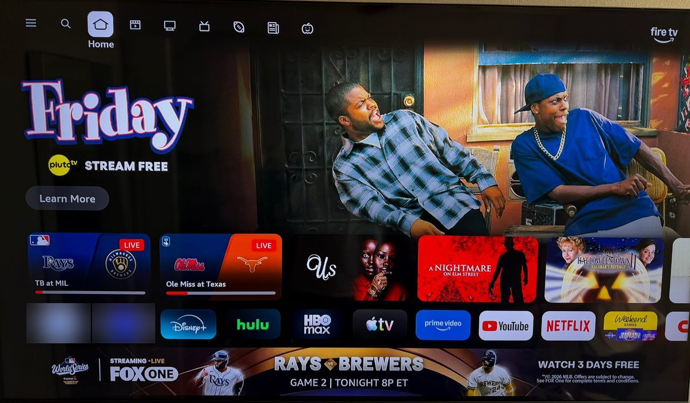
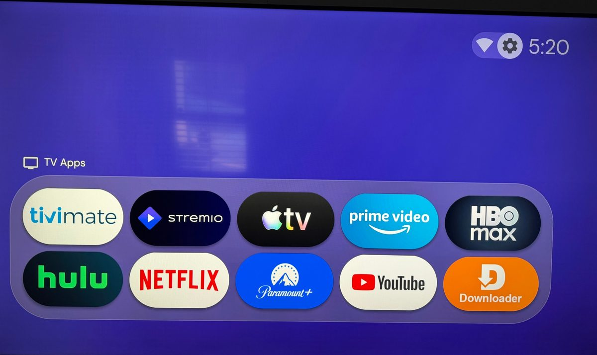

# Fire Stick Debloat

Remove Amazon's ads and tracking from your Fire TV Stick, keep only the apps you actually use, and switch to a clean, minimal home screen.

**[⬇ Download](https://github.com/cmeraspro-dev/Fire-Stick-Debloat/releases/latest/download/Fire-Stick-Debloat-Windows.zip)**. It runs on Windows with a double-click. You don't need any technical knowledge, and nothing is permanent: every change can be undone from the same menu.

| Before: Amazon's home screen | After: clean Projectivy home screen |
|---|---|
|  |  |

> [!WARNING]
> This is an unofficial community tool. It is not made by, affiliated with, or endorsed by Amazon. It changes system settings on your device, and you use it at your own risk. Apps are disabled, never deleted, and **Undo everything** brings them back. Still, if something goes wrong, a factory reset may be the only fix.

## What it does

- **Removes ads and tracking:** Amazon's sponsored "special offers", usage logging, crash reports sent to Amazon, Alexa shopping prompts, and the service that uploads your Wi-Fi passwords to Amazon. Amazon's own home screen still shows its promoted rows if you open it: they're built into it, and removing it would break Settings and the Appstore. That's why the tool replaces it with Projectivy, so you don't land on it in normal use.
- **Lets you pick your apps:** it asks about each Amazon app (Prime Video, Freevee, Music…) and each app you installed. Keep what you use and drop the rest.
- **Sets up a clean home screen:** it walks you through installing [Projectivy Launcher](https://www.apkmirror.com/apk/spocky/projectivy-launcher-android-tv/) and makes it open when you press Home. Prefer a different launcher? The Home button can open any launcher you install, using the free, open-source [Home on Fire](https://github.com/toolicious/home-on-fire) app. Projectivy is still the most reliable choice.
- **Never touches what keeps the stick working:** the system home screen, Appstore, settings, the remote and Alexa, and casting are on a protected list.

## Which Fire Sticks does it work on?

Tested on two Fire TV Stick 4K Max devices (Fire OS 8, Android 11), both managed from the same copy of the tool. To see your version on the TV, go to **Settings → My Fire TV → About → Software Version**.

| Fire OS | Android | What to expect |
|---|---|---|
| 8 | 11 | Tested. Everything works with Projectivy. Another launcher through Home on Fire also works, but Amazon's home screen came back more often in testing. |
| 7 | 9 | Should work fully. It uses the same commands and the same Projectivy version as Fire OS 8, but hasn't been tested. With another launcher, Home can take a few seconds to open it (a Fire OS 7 limit). |
| 6 | 7.1 | The cleanup, Undo and Re-apply should work. Making Home open Projectivy (option 4) may not: Amazon blocked custom home screens in some Fire OS 6 updates, so Projectivy might only open as a regular app. Home on Fire doesn't support Fire OS 6, so other launchers can't take over Home. Untested. |
| 5 (Fire TV Stick 1st and 2nd gen) | 5.1 | The cleanup should work, but **Projectivy can't be installed**, because it needs Android 6 or newer, and Home on Fire doesn't support Fire OS 5. Undo may not bring back every app. Untested. |
| Vega OS (Fire TV Stick 4K Select and other newer models) | none | Won't work. These sticks don't run Android apps and have no ADB Debugging setting. |

Buying a stick for this? The Fire TV Stick 4K Max is the one it's tested on.

If you try it on a version that isn't tested yet, please [report how it went](https://github.com/cmeraspro-dev/Fire-Stick-Debloat/issues/new/choose).

## What you need

- A **Windows** computer on the same Wi-Fi as your Fire Stick (for Mac or Linux, see [below](#mac-and-linux))
- About 20 minutes

## 1. Download

1. Click **[⬇ Download](https://github.com/cmeraspro-dev/Fire-Stick-Debloat/releases/latest/download/Fire-Stick-Debloat-Windows.zip)**. Your browser saves `Fire-Stick-Debloat-Windows.zip`, usually in your **Downloads** folder.
2. Open File Explorer and click **Downloads** on the left. Right-click the zip, choose **Extract All…**, then click **Extract**.
3. A new folder opens with **Start-Here.bat** inside. You'll use it in step 4.

Release notes and older versions are on the [releases page](https://github.com/cmeraspro-dev/Fire-Stick-Debloat/releases).

## 2. Turn off ads in the Fire Stick's own settings

The tool can't change these for you, so do them on the TV with the remote:

1. Press **Home**. Go to the **gear icon** (Settings) at the right end of the menu and press the center button.
2. Open **Preferences**.
3. Open **Featured Content** and turn off video autoplay, audio autoplay and sponsored content. Press **Back**.
4. Open **Privacy Settings** and turn off **Device Usage Data**, **Collect App Usage Data** and **Interest-based Ads**.

## 3. Allow the computer to connect

On the TV, with the remote:

1. Press **Home**. Go to the **gear icon** (Settings) and press the center button.
2. Open **My Fire TV**. On some models it's called **Device & Software**.
3. Open **About**. The first line, with your Fire Stick's name (for example "Fire TV Stick 4K Max"), is highlighted.
4. Press the center button **7 times**. A message counts down at the bottom of the screen, then says "You are now a developer". If it says "No need, you are already a developer", that's fine too.
5. Press **Back** once. **Developer Options** is now in the list. Open it.
6. Turn on **ADB Debugging**. If a warning pops up, confirm it.

You don't need to look up the IP address: the tool finds the Fire Stick on your Wi-Fi by itself. If it can't, the address is under **My Fire TV → About → Network** and looks like `192.168.1.23`.

## 4. Run the tool

1. In the folder from step 1, double-click **Start-Here.bat**. If Windows shows "Windows protected your PC", click **More info → Run anyway**.
2. The first time, it offers to download Google's free Android platform-tools, which it needs to talk to the Fire Stick. Type **y** and press Enter.
3. It looks for your Fire Stick on your Wi-Fi, which takes a few seconds. It only looks on your home network and doesn't save anything. If it can't find the stick, it shows what to check, and you can type the IP address instead.
4. **Look at the TV.** A box asks "Allow USB debugging?". Use the arrows on the remote to highlight **Always allow from this computer** and press the center button to tick it. Then highlight **OK** and press the center button.
5. First time? Type **F**. The tool walks you through everything in order: the ad settings, the cleanup, Projectivy and the Home button. Or pick an option yourself:

| Option | What it does |
|---|---|
| **F** First time? | Walks you through the whole setup, one step at a time. |
| **1** Preview | Shows what would be removed. Changes nothing. Start here. |
| **2** Clean up | Removes ads and tracking, then asks about each app. Type **y** to remove an app, or press Enter to keep it. |
| **3** Undo everything | Brings back everything the tool removed. |
| **4** Choose my home screen launcher | Makes the Home button open Projectivy (recommended), or any other launcher you've installed. For other launchers it installs Home on Fire for you. |
| **5** Install an app file | Installs an `.apk` or `.apkm` from your Downloads folder onto the Fire Stick. |
| **6** Uninstall an app | Completely removes an app you installed. |
| **7** Get Projectivy Launcher | Opens Projectivy's download page, tells you which version fits your Fire Stick, then installs it. |
| **8** Re-apply my cleanup | After a Fire OS update: turns off anything from your cleanup that came back, and gives the Home button back to your launcher. |
| **S** Switch to another Fire Stick | Connects to a different stick without restarting the tool. Each stick keeps its own list of removed apps. |

After cleaning up, let the tool restart the Fire Stick.

When a new version comes out, the tool tells you when it starts and offers to update itself. Your lists of removed apps are kept. Each run is also saved to the `logs` folder, which helps if you need to [report a problem](https://github.com/cmeraspro-dev/Fire-Stick-Debloat/issues/new/choose).

The tool keeps a separate list of what it removed for each Fire Stick (`removed-<serial>.txt` next to `Start-Here.bat`), plus a backup copy on the stick itself. You can use one folder for several sticks, and if you move the folder or use another computer, **Undo** and **Re-apply** still know what to bring back or turn off.

## 5. Make the home screen clean

Option **F** does steps 1 and 2 below for you.

1. Choose option **7** to install Projectivy, then open Projectivy once on the TV.
2. Choose option **4**, then press **Home** on the remote. You should land on Projectivy.
3. In Projectivy's settings (press **Up** to the top bar, then the gear icon):
   - **Edit categories:** hide every row except one. In that row, use **Manage apps** to add only the apps you use.
   - **Launcher wallpaper:** pick a calm collection such as Earth or Astrophotography, and add a little dim or blur if offered.
   - Turn off recommendation rows and any top-bar items you don't use.
   - Use **Backup** to save your setup.

Projectivy is made by Spocky, and its paid version adds your own wallpapers, themes and fonts.

### Using a different launcher

Any Android TV launcher can be your home screen:

1. Install your launcher with option **5**.
2. Choose option **4**, then **2**. The tool downloads [Home on Fire](https://github.com/toolicious/home-on-fire) from its GitHub page, installs it and opens it on the TV. It's a small free, open-source app with no internet access.
3. In Home on Fire, pick your launcher. It can also open your launcher automatically when the stick starts up.

To go back to Projectivy, choose option **4**, then **1**. Only one of them controls the Home button at a time.

In testing on a Fire TV Stick 4K Max, Home on Fire did open another launcher, but Amazon's home screen came back more often than with Projectivy, so Projectivy is still the recommended choice. If Amazon's screen keeps coming back, hold the remote's **☰ Menu** button to open Home on Fire's settings and try turning off its double-press escape to Amazon's home screen.

### Optional: Seeker TV

[Seeker TV Launcher](https://github.com/TWBankston/Seeker-TV-Launcher) shows your apps as a spinning dot-matrix wheel, with optional arcade-style modes. To try it:

1. Download `seeker-wheel-….apk` from its Releases page.
2. Install it with option **5**.
3. Open it from Projectivy, or make it your home screen as described in [Using a different launcher](#using-a-different-launcher).

**Don't follow Seeker's own install guide or run its `panic-home.sh` script.** They're written for Google TV, and the script switches off whichever app controls your Home button.

## Troubleshooting

| Problem | Fix |
|---|---|
| The tool can't find or reach the Fire Stick | Check that the TV is on, both devices are on the same Wi-Fi, and ADB Debugging is on ([step 3](#3-allow-the-computer-to-connect)). If it still isn't found, type the IP address from **My Fire TV → About → Network**. |
| A window says the files haven't been unzipped | Start-Here.bat was opened from inside the zip. Right-click the zip, choose **Extract All…**, and run Start-Here.bat from the new folder. |
| Nothing happens after connecting | Look at the TV for the permission popup and select **OK**. |
| `INSTALL_FAILED_OLDER_SDK` | That app version needs a newer Android than your Fire Stick has. Download a variant whose minimum version is your Android version or lower. |
| A Fire OS update brought back ads, apps or Amazon's home screen | Run the tool and choose **8** (Re-apply my cleanup). |
| Amazon's home screen flashes, or comes back when you press Home quickly | This is normal on Fire TV. Amazon's home screen always gets the Home button first, and Projectivy (or Home on Fire) jumps in front of it after a short delay that Fire OS adds. Press Home once and wait a second. If Amazon's screen stays, press Home once more. ([Projectivy issue #338](https://github.com/spocky/miproja1/issues/338)) |
| "Android settings" in Projectivy only blinks | Fire TV's settings screen is built into Amazon's home screen, so Projectivy takes over again straight away. **Hold down the Home button** instead, then choose **Settings** from the menu that pops up. |
| You need Amazon's home screen while Home on Fire is in charge | **Hold down the Home button.** Home on Fire lets that through to Amazon's home screen, where Settings is too. |
| An app is listed as "couldn't remove" | Newer Fire OS protects some built-in apps. That's harmless. |
| Something stopped working | Choose **3** (Undo everything) and restart the Fire Stick. |

When you're done, you can turn **ADB Debugging** off again. You'll need it back on to use the tool later.

## Mac and Linux

> [!NOTE]
> The Mac/Linux scripts haven't been tested on a real Fire Stick yet. Start with `--dry-run`, and please [report how it goes](https://github.com/cmeraspro-dev/Fire-Stick-Debloat/issues/new/choose).

The [`mac-linux`](mac-linux) folder has `debloat.sh` and `restore.sh`. They cover the cleanup only (removing ads, tracking and unwanted apps) and need `adb` installed: `brew install android-platform-tools` on Mac, or `sudo apt install adb` on Linux. Run them from Terminal:

```bash
./mac-linux/debloat.sh 192.168.1.23 --dry-run   # preview
./mac-linux/debloat.sh 192.168.1.23             # clean up
./mac-linux/restore.sh 192.168.1.23             # undo
```

## Credits

- [Android SDK Platform-Tools](https://developer.android.com/tools/releases/platform-tools) by Google, downloaded from Google when the tool first runs
- [Projectivy Launcher](https://www.apkmirror.com/apk/spocky/projectivy-launcher-android-tv/) by Spocky
- [Seeker TV Launcher](https://github.com/TWBankston/Seeker-TV-Launcher) by TWBankston
- [Home on Fire](https://github.com/toolicious/home-on-fire) by toolicious, downloaded from its GitHub page when you choose another launcher

## License

[MIT](LICENSE). Amazon, Fire TV and Fire Stick are trademarks of Amazon.com, Inc. or its affiliates.
